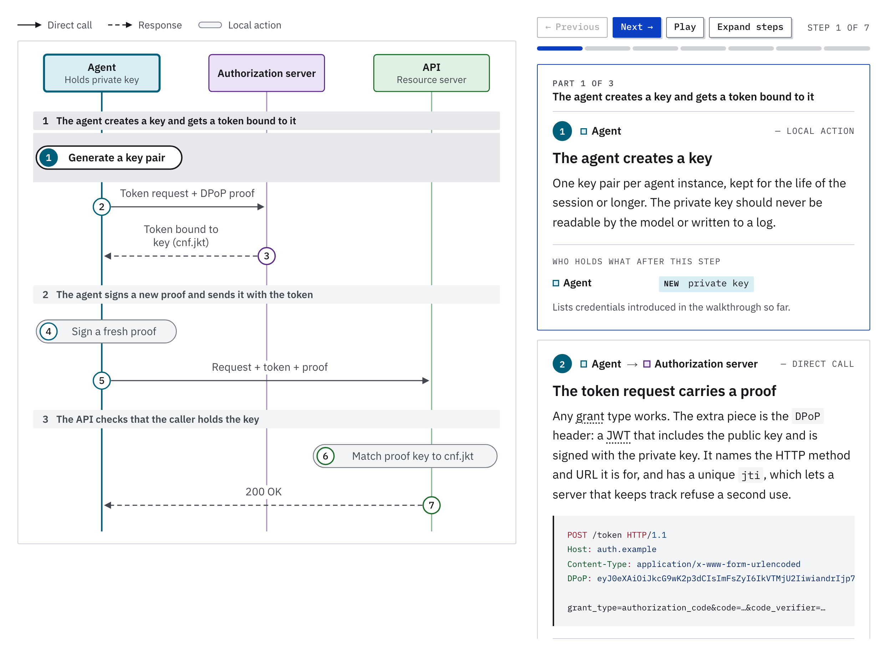

# Who’s on First

**A field guide to agent authentication and authorization: who is acting, for whom, and who said they could.**

[](https://github.com/kevinswiber/whosonfirst.ai/actions/workflows/ci.yml)
[%22&replace=%241&label=reviewed&color=blue)](https://whosonfirst.ai/about/#how-facts-were-checked)
[](https://whosonfirst.ai/llms.txt)
[](LICENSE-CONTENT)
[](LICENSE)

**Read it at [whosonfirst.ai](https://whosonfirst.ai).** This repository is the site’s source, and where corrections are filed.

<a href="https://whosonfirst.ai/flows/dpop/">
  <picture>
    <source media="(prefers-color-scheme: dark)" srcset="docs/images/flow-dpop-dark.png">
    
  </picture>
</a>

Every API an agent calls needs three answers: which software is calling, which person it is working for, and what that person approved. An API key gives one of them. Who’s on First starts from that key and goes as deep as the specifications, for an agent with a person present, with a person on call, and with no human at all.

It is an independent reference, not a specification. Every page says which month it was last checked against its sources, and links to them.

## Where to start

| If you…                                         | Go to                                                                                                                                                                                   |
| ----------------------------------------------- | --------------------------------------------------------------------------------------------------------------------------------------------------------------------------------------- |
| are new to this                                 | **[The lessons](https://whosonfirst.ai/learn/)**: 6 short lessons, about 40 minutes, starting from an API key. No OAuth knowledge needed.                                               |
| are designing an agent                          | **[The decision guide](https://whosonfirst.ai/guide/)**: six questions that turn your agent’s situation into a short list of flows, with reasons.                                       |
| know which flow you need                        | **[The flows](https://whosonfirst.ai/flows/)**: 20 flows, each a sequence diagram you can step through, with the messages on the wire and what each party has to do.                    |
| are looking for an implementation               | **[In the field](https://whosonfirst.ai/field/)**: documented product roles, named production reports, sources and dates. Browse the overview, then open a flow’s full evidence record. |
| need to know what changes where your agent runs | **[The deployment guides](https://whosonfirst.ai/deployments/)**: hosted apps, Kubernetes, managed agent platforms, local machines and CI, sandboxes, and gateways.                     |
| need to know how settled a specification is     | **[The standards tracker](https://whosonfirst.ai/standards/)**: more than 90 RFCs, drafts, specifications and projects, each with its status and why it matters for agents.             |
| met a word you do not know                      | **[The glossary](https://whosonfirst.ai/glossary/)**, or the whole model on one page in **[Concepts](https://whosonfirst.ai/concepts/)**.                                               |

## What is in it

### Lessons

Each answers one question and builds on the one before, with one example throughout and a figure that makes its point before anything is clicked.

1. [What does the API actually see?](https://whosonfirst.ai/learn/what-the-api-sees/)
2. [What is a token?](https://whosonfirst.ai/learn/tokens/)
3. [How does an agent get a token for a user?](https://whosonfirst.ai/learn/getting-a-token/)
4. [What if nobody is there to sign in?](https://whosonfirst.ai/learn/whose-authority/)
5. [What happens when the agent calls a tool that calls an API?](https://whosonfirst.ai/learn/chains/)
6. [What limits the damage when something goes wrong?](https://whosonfirst.ai/learn/limits/)

### Flows

Grouped by the question that matters most when choosing between them: is a person involved, and when? Each flow is rated by how settled the standards it requires are.

**A person is present**

- [Authorization code with PKCE](https://whosonfirst.ai/flows/authorization-code-pkce/): the baseline. A person signs in, approves specific scopes, and the agent receives a token that says so.
- [Device authorization](https://whosonfirst.ai/flows/device-authorization/): for agents with no browser of their own.
- [MCP authorization](https://whosonfirst.ai/flows/mcp-authorization/): how an MCP client that has never seen a server before discovers where to sign in, identifies itself, and gets a token good for that server alone.

**A person is in the loop**

- [Step-up authorization](https://whosonfirst.ai/flows/step-up-authorization/): start with a weak token, and ask the user for exactly what a sensitive action needs.
- [Backchannel approval (CIBA)](https://whosonfirst.ai/flows/ciba/): approval arrives as a push notification, not a redirect.
- [URL elicitation](https://whosonfirst.ai/flows/url-elicitation/): a tool hands back a link, the user signs in elsewhere, and the secret never touches the agent.
- [AAuth](https://whosonfirst.ai/flows/aauth/): the agent signs requests with its own key; in the calendar flow shown, a user-chosen server vouches for the person and their consent.

**Delegation chains**

- [Token exchange](https://whosonfirst.ai/flows/token-exchange/): trade the token you were given for one that names both the user and the service now acting for them.
- [Enterprise-managed authorization (ID-JAG)](https://whosonfirst.ai/flows/cross-app-access/): the company identity provider decides which agents may reach which apps for which employees.
- [Identity chaining](https://whosonfirst.ai/flows/identity-chaining/): carry who-is-this-for across an organizational boundary.
- [Transaction tokens](https://whosonfirst.ai/flows/transaction-tokens/): a short-lived token that pins down one transaction and travels the whole call chain.

**No human**

- [Client credentials](https://whosonfirst.ai/flows/client-credentials/): the agent authenticates as itself.
- [Workload identity federation](https://whosonfirst.ai/flows/workload-identity-federation/): the platform the agent runs on vouches for it, and nothing long-lived is stored.
- [SPIFFE and mutual TLS](https://whosonfirst.ai/flows/spiffe-workload-identity/): a cryptographic identity from the infrastructure, used at both ends of every connection.
- [Workload tokens (WIMSE)](https://whosonfirst.ai/flows/wimse-workload-tokens/): a workload identity bound to a key and proven on every request.

**Agent to agent, agent to web**

- [Agent to agent (A2A)](https://whosonfirst.ai/flows/agent-to-agent/): one agent discovers another, reads what credentials it wants, and presents them.
- [Web Bot Auth](https://whosonfirst.ai/flows/web-bot-auth/): an agent that browses the open web signs its requests, so a site can tell which operator it belongs to.
- [Agent payments (AP2)](https://whosonfirst.ai/flows/agent-payments/): the user signs what the agent may buy, and the agent proves a purchase falls inside it.

**Cross-cutting**

- [DPoP](https://whosonfirst.ai/flows/dpop/): bind a token to a key, so that stealing the token is not enough to use it.
- [Credential broker](https://whosonfirst.ai/flows/credential-broker/): the agent never holds the secret. A proxy outside the sandbox adds it to outgoing requests.

### Deployment guides

The flows are the same everywhere. What changes with the runtime is the starting credential.

- [Hosted apps and backends](https://whosonfirst.ai/deployments/web-apps/)
- [Kubernetes](https://whosonfirst.ai/deployments/kubernetes/)
- [Managed agent platforms](https://whosonfirst.ai/deployments/agent-platforms/)
- [Desktop, IDE, CLI and CI](https://whosonfirst.ai/deployments/local/)
- [Sandboxed agents](https://whosonfirst.ai/deployments/sandboxes/)
- [MCP and LLM gateways](https://whosonfirst.ai/deployments/gateways/)

## Read it with an agent

Every page of the guide is also published as Markdown, made from the page as built, so an assistant or a coding agent can read the guide without picking it out of HTML. A copy keeps what the page says in words: a flow’s steps, every variation of a figure, the decision guide’s rules.

| What                                 | Address                                                                                                                       |
| ------------------------------------ | ----------------------------------------------------------------------------------------------------------------------------- |
| An index of every page, in order     | [`https://whosonfirst.ai/llms.txt`](https://whosonfirst.ai/llms.txt)                                                          |
| Every page in one file, about 650 kB | [`https://whosonfirst.ai/llms-full.txt`](https://whosonfirst.ai/llms-full.txt)                                                |
| One page                             | The page’s address and `index.md`: [`https://whosonfirst.ai/flows/dpop/index.md`](https://whosonfirst.ai/flows/dpop/index.md) |

Each page also names its copy in a `<link rel="alternate" type="text/markdown">`, and `robots.txt` says, in the terms of [contentsignals.org](https://contentsignals.org/), that the site may be indexed, used to answer questions, and used for training.

Some ways to put that to work:

**Ask an assistant that can browse.** Give it the index and your situation:

```text
Read https://whosonfirst.ai/llms.txt, then the pages that apply.

My agent runs as a Kubernetes CronJob with nobody signed in, and calls a
vendor's HTTP API. How should it authenticate, and what should I watch out
for? Say which pages you used and the month each was last reviewed.
```

**Give a coding agent a standing pointer.** In `AGENTS.md`, `CLAUDE.md` or your editor’s rules file:

```markdown
## Authentication and authorization

When a change touches how this service or its agents sign in, obtain tokens
or call other APIs, read https://whosonfirst.ai/llms.txt and the Markdown
pages it links to that apply before proposing a design. Check the design
against the flow page's "Watch out for" section, and name the pages you used.
```

**Review a design against it.** Hand an agent your design notes and the flow page you are following, and ask it which of the page’s cautions apply and which steps the design leaves out. “Who does what” on each flow page says what each party has to do, which is most of a review checklist.

**Load the whole guide.** Download `llms-full.txt` and add it to a project’s knowledge or a retrieval index:

```bash
curl -O https://whosonfirst.ai/llms-full.txt
```

It is more than some models take in one prompt. For a single question, the index is the better start.

**Build on the data.** The flows, the standards tracker and the glossary are typed data files in [`src/data/`](src/data/), under the same license as the text.

Two things to ask of any agent that reads it:

- **Cite the page, not the copy.** The address without `index.md` is the one a person can open.
- **Carry the review month along.** Drafts in this area change monthly, and each page and each copy says when the site was last checked. For anything a decision rests on, have the agent follow the page’s link to the specification itself.

## Accuracy

A reference is only worth having if it is right. In the tracker, IETF revision numbers, dates and process states (for example “in last call”) were read from the IETF datatracker and the RFC Editor, and other revisions from specification repositories. A state worded as reported came from a secondary source. Vendor products are described from vendor documentation and were not tested, and mention is not recommendation. The [About page](https://whosonfirst.ai/about/) has the full method, and [`docs/source-review.md`](docs/source-review.md) is the checklist for each review.

**Found something wrong or out of date?** [Open a correction](https://github.com/kevinswiber/whosonfirst.ai/issues/new/choose) with the page, what it says, and a link to the source that shows otherwise, or send the change as a pull request. A revision number or a status that has moved is worth an issue by itself. [CONTRIBUTING.md](CONTRIBUTING.md) says what a correction needs.

## About

Written and maintained by [Kevin Swiber](https://www.linkedin.com/in/kevinswiber). The name is from Abbott and Costello’s routine, in which a man asks who is playing first base and never gets an answer he can use. Ask a production system which person an API call was made for, and which software made it, when an agent sat in between, and the conversation is often the same.

The site is static. It sets no cookies and loads nothing from another origin, and every page reads correctly with JavaScript off.

## Working on the site

Requires Node 22 or later.

```bash
npm install
```

```bash
npm run dev
```

[`docs/development.md`](docs/development.md) says how the site is built, where things are, how content is edited and what the checks cover. The same checks run on every pull request.

## License

The code is under the [MIT license](LICENSE): the layouts, components, scripts, styles and build steps.

The site’s content is under [Creative Commons Attribution 4.0](LICENSE-CONTENT): the text of the pages, the diagrams, the data in `src/data/`, the documents in `docs/`, and what the build makes from them. Use it and adapt it, and credit “Who’s on First” with a link to [whosonfirst.ai](https://whosonfirst.ai).

The fonts are IBM Plex, from the `@fontsource` packages, under the SIL Open Font License.
