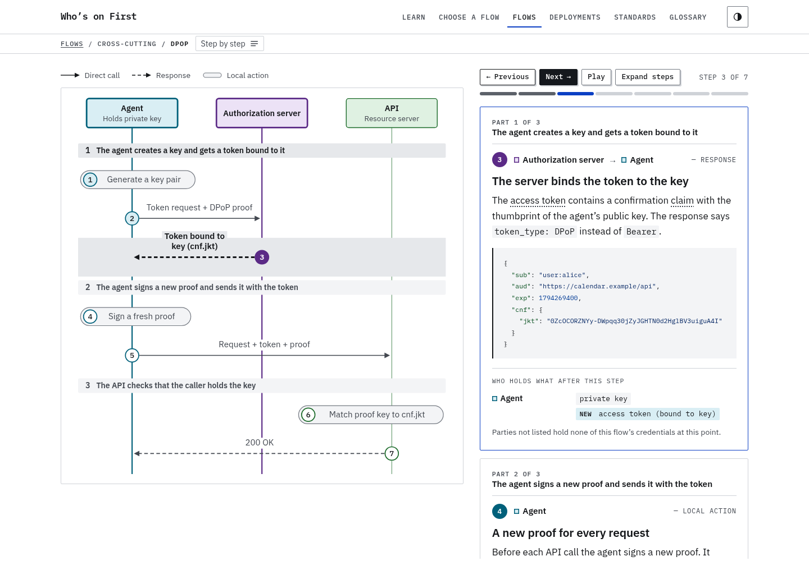
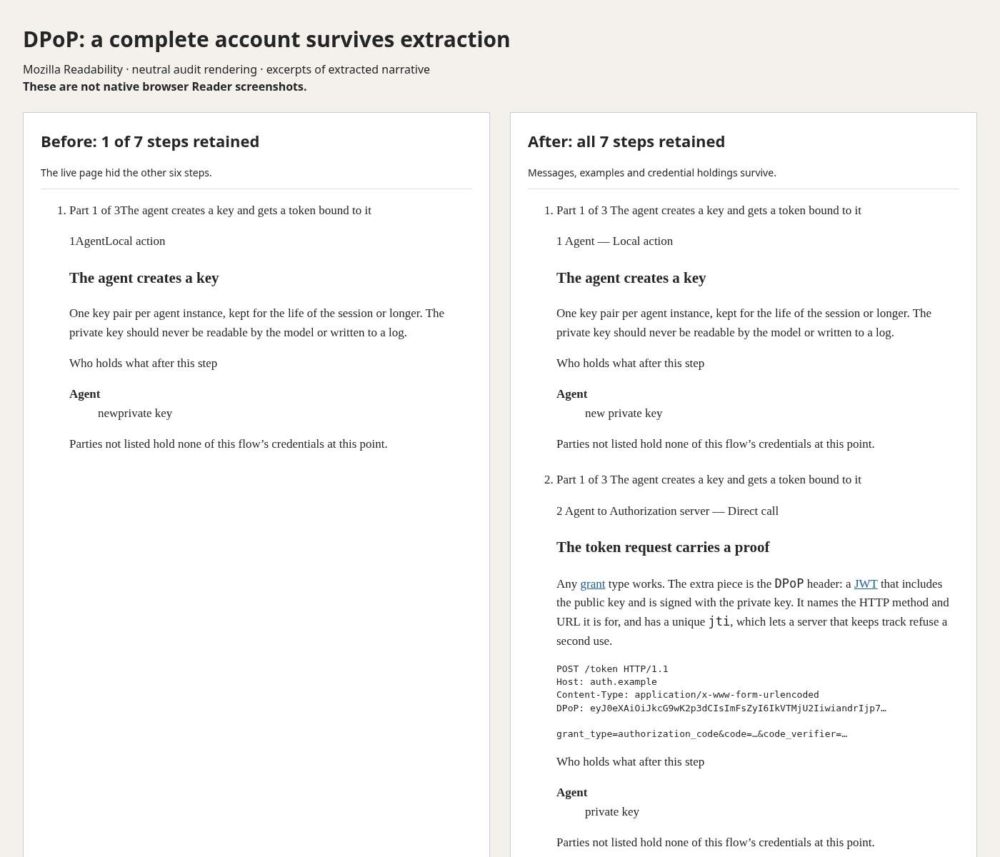
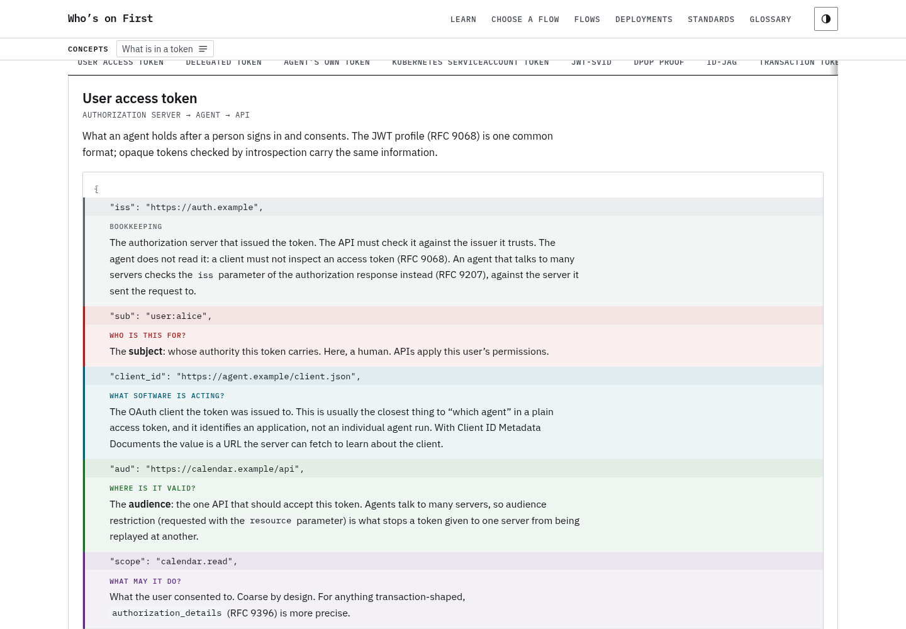
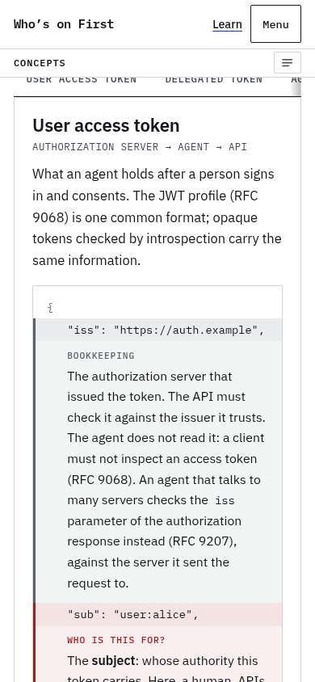
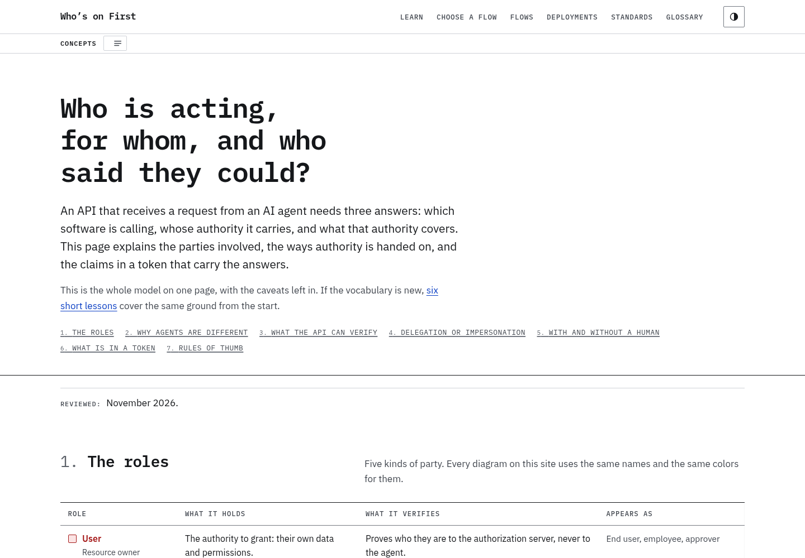
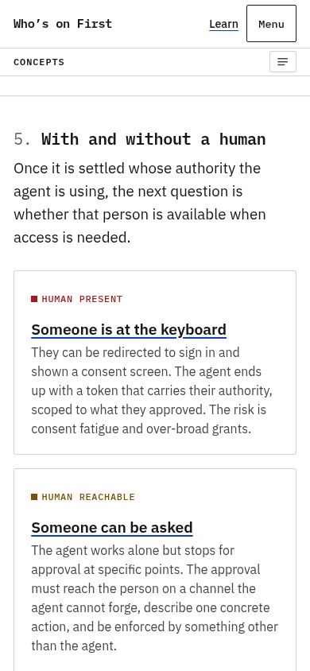

# Reading modes across the site

Investigation for [issue #55](https://github.com/kevinswiber/whosonfirst.ai/issues/55).

## Decision

Keep one complete HTML account of each subject. A selected diagram step may be
highlighted and scrolled into view, but selecting it must not hide the other
steps. Token examples and Kubernetes identity layers follow the same rule.
Navigation uses `nav`; the redundant flow drawing is complementary `aside`
content. Titles and introductions belong to the same article as their body.
Sources are content, not page footers.

Do not add a second reader page or a custom reading-mode switch. Native reading
modes provide the reader's preferred type, spacing and colors. The site's
Markdown copies remain useful for programs, but do not repair native Reader.
Print rules are separate: extraction does not apply `@media print`.

## Evidence and limits

The baseline is commit `eb2e06d6914e53cb628ede95974ec40f7a6da052`.
An exploratory audit ran Mozilla's published `Readability.js` against a clone of
the live desktop DOM after JavaScript initialized, using installed Chromium
156.0.8078.79. This tests one extraction algorithm, **not Firefox Reader View,
Safari Reader or Chrome Reading mode**. No extraction library was added to the
site or its dependencies.

Source: [Mozilla Readability](https://github.com/mozilla/readability/blob/main/Readability.js),
SHA-256 `e9330028c8a5a4aa7d75147be2605d520f7f213c7b28474947dc0e9c984e9bed`.
The audit loads a page, evaluates
`new Readability(document.cloneNode(true)).parse()`, then compares its content
with the original headings, step messages, code examples, credential holdings,
comparison tables, and source links. Inspect extracted HTML as well as text:
a heading mentioned inside a drawing is not a retained narrative step.

To repeat against a current build, obtain that source separately and run:

```bash
node scripts/reader-audit.mjs /path/to/Readability.js /tmp/reader-audit-output
```

The script writes extracted HTML and an `audit.json` report. It also opens both
flows at step 2 to check that selection does not change the extracted account.
This is an exploratory report, not a required CI dependency or pass/fail claim
about native browsers.

Before the change:

- DPoP retained one of seven narrative steps; six had `hidden` set.
- MCP authorization retained one of fourteen; thirteen had `hidden` set.
- Flow drawings survived as loose SVG labels and the step counter survived as
  an isolated fragment.
- The tokens lesson and Kubernetes guide lost their article introductions.
- The standards tracker kept 96 entry headings, but source footers disappeared.
- Concepts retained only the initially selected token example.

After the change, the same extractor retained all seven DPoP steps and all
fourteen MCP authorization steps, both initially and when opened at step 2.
All 18 DPoP and 32 MCP message, code and holdings fragments survived text
comparison. No flow SVG or step-navigation controls remained. The tokens and
first lessons and Kubernetes guide retained their introductions. It also retained:

- Both audited lesson comparison tables in full.
- All five Kubernetes identity-layer accounts.
- All nine Concepts token examples and their 23 source links.
- All 99 standards source blocks and their 222 links.

Some short header taglines still fall outside the extracted article, including
MCP authorization, Standards, Concepts and the glossary. MCP's full introduction
and “In short” summary survive. The report records `introductionRetained`
separately, so complete step extraction cannot be mistaken for complete page
extraction. Navigation and interactive self-checks are not expected to survive.

The images below show the normal desktop page and a neutral rendering of the
audit's extracted narrative. The comparison is an excerpt: its counts come from
the full audit, and its typography is not a native browser Reader theme. Generate
the extracted HTML with `reader-audit.mjs` before capturing equivalent excerpts.
The desktop capture uses the built MCP page at step 3, at 1440 pixels wide.





Native browser follow-up is tracked in [issue #59](https://github.com/kevinswiber/whosonfirst.ai/issues/59).

Native Safari and Firefox were not available on this Linux executor. Direct
navigation to Chromium's reading side-panel internal URLs returned
`ERR_INVALID_URL`; that does not establish whether its UI can open Reading mode.
Native Chromium Reading mode has not been validated on this executor. These remain manual checks,
including entering Reader after Next, after opening a diagram, and after using
lookup or filters. Browser-specific extraction is not a stable web API.

The user's Chrome Reading Mode review of the MCP preview on November 12, 2026
reported concatenated standard labels (`RFCRFC 7591`) and glossary terms whose
popovers did not transfer. The supplied screenshot shows readable introductory
prose; copied text is not a reliable record of the browser's formatting.
Standard cards now put `·` in the HTML, rather than relying on a CSS gap.
Glossary terms remain links and always navigate when activated; optional
definitions preview on hover or keyboard focus on the normal page. This also
avoids intercepting Chrome's action on the original link:
[Chromium's Reading Mode handler](https://github.com/chromium/chromium/blob/main/chrome/browser/ui/webui/side_panel/read_anything/read_anything_untrusted_page_handler.cc)
implements `OnLinkClicked` with the target node's default accessibility action.
The regression checks cover link semantics, pointer, keyboard, touch and
programmatic activation, preview dismissal and literal metadata separators.
The user's follow-up screenshot at 20:50 UTC confirms that glossary terms render
as links in Chrome Reading Mode, and the accompanying capture contains the
literal standard separators. It does not establish link activation or behavior
on other pages. These automated checks do not simulate Reading Mode itself.

The next pass addresses remaining structure and content availability:

- Visual number badges no longer duplicate the ordered lists' accessible
  numbering. A phase is introduced only at its first step; Markdown and social
  cards retain their own explicit step and phase context.
- All 71 token claim explanations on Concepts are visible. Previously only 9
  were visible, and closed notes were missing from Chromium's accessibility
  tree, despite being present in the DOM-based extraction audit.
- Ordinary uses of “claim” and “state” no longer link to JWT and OAuth terms.
  Authors link those technical meanings explicitly.
- Flow and guide review facts sit with their narrative, and Concepts keeps its
  review facts in its main content. The component's neutral `page-facts` class
  avoids Readability's negative match on `meta`.
- The standards tracker and token source lists have literal separators too.

The repeated audit retains 19/19 DPoP and 33/33 MCP narrative/provenance
fragments, including entry at step 2; all 271 Concepts token/provenance leaf
fragments and 23 source links; five Kubernetes layers and its review line; and
99 standards source blocks with 222 links. Token code, labels and paragraphs
are compared within each example: extractors can change block boundaries
without losing words. The standards tracker and home review lines still fall
outside this extractor's selected content, as do the short taglines noted
above. Native checks of the latest structure remain open in #59.

The screenshots below show the normal site, not a native Reader theme.





### Concepts follow-up

The user's Chrome Reading Mode screenshot at 21:16 UTC on November 12 shows
the document title replacing the page heading, the opening prose missing, and
review details running together. Its accompanying capture retains all nine
annotated tokens but omits the three human-involvement explanations. The five
delegation alternatives also need headings independent of their diagram labels.

Concepts now puts its heading, introduction and sections in one article. It
keeps the review date without repeating the introductory description in a
disclosure. Shared review values and notes use paragraphs, literal spacing and
body-sized text. Comparison tables also put literal spaces between labels and
explanations.
All five delegation alternatives are visible sections with headings; their
navigation links jump to each section. The three human-involvement cards keep
their prose outside their heading links, reducing the risk of extraction as
navigation. The warning that follows has a real heading.

The repeated Readability audit retains the original page heading and opening
prose, all 295 checked Concepts fragments, and 23 token source links. This
supersedes the Concepts tagline omission recorded above. The rendered checks
also cover these sections with JavaScript on and off and verify that the jump
links reach visible headings. Native Chrome validation of this follow-up is
still tracked in #59; the extraction audit is not a substitute for that check.





## What belongs in each mode

| Page family        | Reading-mode expectation                                                                                                                 |
| ------------------ | ---------------------------------------------------------------------------------------------------------------------------------------- |
| Flows              | Summary, every ordered step, message examples and credential holdings; no navigation controls or loose diagram labels.                   |
| Lessons            | Introduction, explanation, all comparison outcomes, takeaways and further reading. Interactive self-checks may be omitted by extractors. |
| Deployment guides  | Introduction, all identity layers and their limits, examples and checklist.                                                              |
| Concepts           | Introduction, roles, every delegation and human-involvement alternative, and every token example with its explanation.                   |
| Standards          | Every entry in the unfiltered page, status and links to its sources. Clear filters before entering Reader.                               |
| Glossary and About | Definitions and explanatory prose.                                                                                                       |
| Home and indexes   | Navigation is their purpose; native Reader may decline these pages.                                                                      |
| Decision guide     | The live page is the appropriate interface for questions and computed results; extraction is not a replacement for the tool.             |

## Regression coverage

`npm run check:rendered` checks every flow with JavaScript disabled and after
stepping with JavaScript enabled. It requires all steps in order, with headings
and messages, and refuses hidden narrative, code examples or holdings. It also
checks that every token and Kubernetes comparison panel remains available
without selecting it. Existing keyboard, responsive, contrast, accessibility
and print checks continue to apply.

These checks guard the input given to extractors. They do not assert that an
undocumented native reading mode keeps everything. Repeat the extraction audit
and native browser checks when article structure or interactive controls change.
